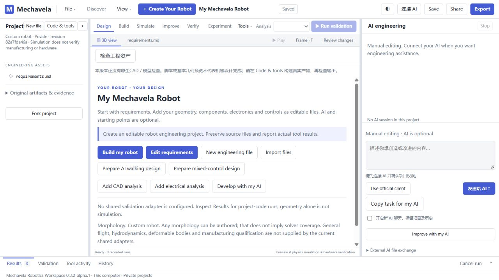

# Mechavela

**Your AI. Real CAD. Real simulation. One robotics workspace.**

[简体中文](README.zh-CN.md) · [Get started](docs/GETTING_STARTED.md) · [What is verified](docs/CAPABILITIES.md) · [Release notes](CHANGELOG.md)



Mechavela is a local robotics development workspace for **your own AI**. Describe a robot, let your AI write and edit project code, call established engineering tools, inspect real results, and iterate in an editable workspace.

The platform supplies tools and feedback. Robot designs, controllers, planning and gait algorithms belong in user projects, not a growing collection of hardcoded robot-specific answers.

## What you can do

- Create, save and reopen private local robot projects.
- Connect your official Codex client or configure a supported tool-calling API model. Your AI account and usage remain with your provider.
- Allow project-scoped file edits and explicitly approve trusted local code execution.
- Run project tools through extensible manifests; add tools without rewriting the platform core.
- With a qualified FreeCAD environment: create editable mechanical solids, export FCStd/STEP, inspect assembly interference, clearances and axes, and display detailed tessellated CAD with a selectable assembly tree.
- With a compatible MuJoCo environment: run dynamics, inspect recorded results and let your AI revise code and parameters.

## Try the source preview

**Windows 10/11, Python 3.12+ recommended.** Download this repository, extract it, and double-click `Launch-Mechavela.cmd`, or run:

[Download the source preview](https://github.com/ZqiEE/mechavela/releases/tag/v0.3.2-alpha.2)

```sh
python launch.py
```

The workspace opens at `http://127.0.0.1:8890/workspace.html`. Basic project management starts with Python's standard library. **CAD, physics, MCP and AI are external dependencies; the source ZIP does not include their runtimes.** See the [setup guide](docs/GETTING_STARTED.md) before expecting those tools to run.

User data is separate from the previous RLSOK application. This preview does not migrate, overwrite or delete old installations or projects. Internal protocol names remain compatible with that codebase.

## Real engineering example

The development environment produced a **465-solid / 44-group editable mechanical spider assembly** using FreeCAD/Open CASCADE. The latest structural repair passed 352 individual joint configurations, 25 additional configurations and CAD checks of all 41 recorded configurations from a real 10-second, 10,000-step MuJoCo folding/unfolding run.

These are scoped development results, **not an out-of-box reproduction claim for a new machine**. The experiment used a suspended fixed base and ideal drives. Some recorded foot positions were below the ground plane; grounded transformation, walking, rolling, strength and hardware remain unverified. The private project and its logs are not included in this public source snapshot.

## Preview boundaries

- This is a **source technology preview**, not a signed Windows installer or a production-ready robot generator.
- FreeCAD/native dependencies must be allowed by your OS and qualified separately. Never disable security protections to run CAD.
- Trusted local project code runs with your user file/network access. Resource limits are **not a security sandbox**.
- The official MuJoCo WASM cycle was verified as a project tool; it does not turn the default native-Python physics badge into a pass.
- Linux/macOS full workflows, a second clean Windows machine and a fresh-account AI login have not been accepted for this release.
- Some inherited panels and optional reference examples need assets/tools not distributed here. Start with a blank custom project.

## Feedback

Please open an [issue](https://github.com/ZqiEE/mechavela/issues) with your OS, Python/tool versions, steps and the visible error. **Do not upload API keys, connection credentials, private projects or unredacted journals.**

This preview does not select a new license for inherited project-authored code. See [LICENSE-STATUS.md](LICENSE-STATUS.md) and [THIRD_PARTY_NOTICES.md](THIRD_PARTY_NOTICES.md). It is not advertised as an open-source license grant.
