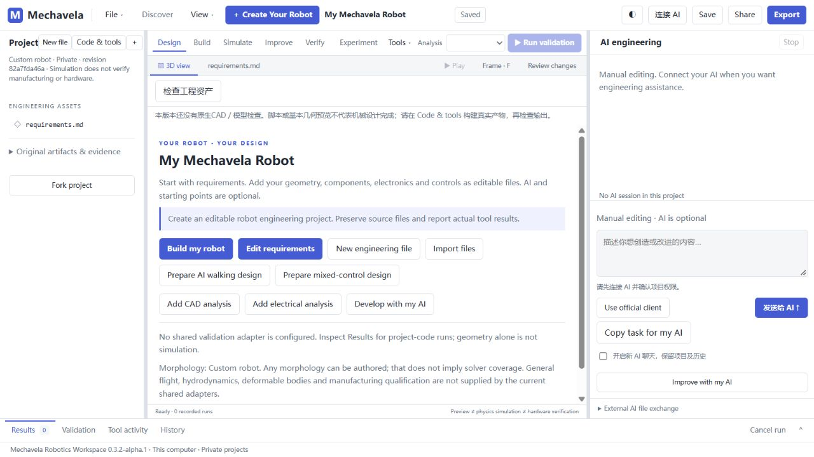

# Mechavela

**连接你的 AI，用真实 CAD 和物理仿真创造机器人。**

[English](README.md) · [开始使用](docs/GETTING_STARTED.md) · [真实能力与边界](docs/CAPABILITIES.md)



Mechavela 是运行在本机的 AI 机器人研发工作区。用户提供自己的 AI，描述需求，让 AI 编写和修改项目代码、调用成熟工程工具、读取真实反馈，并持续修正设计。

## 现在能做什么

- 创建、保存和重新打开机器人项目。
- 连接官方 Codex 客户端或兼容工具调用的 API 模型。
- 按项目授权文件编辑；高风险本地执行需要明确授权。
- 通过项目工具清单接入工具，不为每种机器人在核心增加专用算法。
- 配置可信 FreeCAD 后：生成可编辑实体、导出 FCStd/STEP，检查干涉、间隙和轴线，在 3D 工作区查看精细 CAD、选择和隔离零件。
- 配置兼容 MuJoCo 后：执行真实动力学计算，将结果交给 AI 修改代码和参数。

## 运行预览

建议 Windows 10/11 和 Python 3.12+。下载并解压仓库，双击 `Launch-Mechavela.cmd`，或执行：

```sh
python launch.py
```

浏览器打开 `http://127.0.0.1:8890/workspace.html`。基础项目管理使用 Python 标准库即可启动。**源码包不包含 CAD、物理引擎、官方 AI 客户端及 MCP 依赖**；完整工程流程需要另行配置，见[入门说明](docs/GETTING_STARTED.md)。

新版使用独立 Mechavela 数据目录，不自动迁移或覆盖旧 RLSOK 安装和项目。

## 已有真实案例

开发环境中，FreeCAD/Open CASCADE 已生成 465 个实体、44 个分组的机械蜘蛛装配。膝部修复经过 352 个逐关节姿态、25 个额外姿态和真实 MuJoCo 10 秒/10000 步折叠—展开过程的全部 41 个记录姿态 CAD 检查。

这是悬空固定基座和理想驱动条件下的限定验收。轨迹部分足端低于地面，不能宣传为地面变形、行走或滚动成功；强度、制造和硬件尚未验收。原私有项目及运行日志没有上传到本仓库。

## 需要知道

当前发布为源码技术预览，没有签名安装包。未完成第二台干净 Windows 电脑的全流程验收。可信本地代码具有当前用户的文件和网络访问权，资源限制不是安全沙箱。不要关闭 Windows 防护来运行工具。

欢迎提交体验反馈；请勿上传密钥、权限文件或未经脱敏的工程日志。继承源码尚未选择新的再分发许可证，不宣称已作开源授权，见 [LICENSE-STATUS.md](LICENSE-STATUS.md)。
